# Fundamentals of Data Science Experiments (CS23334)

Lab experiments for **CS23334 – Fundamentals of Data Science**.

Every experiment file is in the main folder, named by its experiment number:

| File / Folder | What it has |
|---|---|
| `expXX.py` | Python scripts – run any of them live |
| `expXX_output.png`, `expXX_graphN.png` | Output pictures for each experiment, next to its script |
| [`docs/`](docs) | Lab record PDFs with aim, description, code and sample output |
| [`data/`](data) | All datasets (CSV) used by the experiments |

## Experiments

| Exp | Title | Script | Record |
|---|---|---|---|
| 1a | Trend of data science job postings over the last decade | [py](exp01a.py) | [pdf](docs/exp01a.pdf) |
| 1b | Distribution of data science roles | [py](exp01b.py) | [pdf](docs/exp01b.pdf) |
| 1c | Structured, unstructured and semi-structured data | [py](exp01c.py) | [pdf](docs/exp01c.pdf) |
| 1d | Encrypt and decrypt sensitive data | [py](exp01d.py) | [pdf](docs/exp01d.pdf) |
| 3a | Data visualization – line plot | [py](exp03a.py) | [pdf](docs/exp03a.pdf) |
| 3b | Data visualization – bar chart | [py](exp03b.py) | [pdf](docs/exp03b.pdf) |
| 3c | Data visualization – pie chart | [py](exp03c.py) | [pdf](docs/exp03c.pdf) |
| 4 | Word frequency in a body of text (NLTK) | [py](exp04.py) | [pdf](docs/exp04.pdf) |
| 5 | Data collection and initial exploration (diabetes) | [py](exp05.py) | [pdf](docs/exp05.pdf) |
| 6 | Time series analysis of website traffic | [py](exp06.py) | [pdf](docs/exp06.pdf) |
| 7 | Random sampling and sampling distribution | [py](exp07.py) | [pdf](docs/exp07.pdf) |
| 8 | Z-test | [py](exp08.py) | [pdf](docs/exp08.pdf) |
| 9 | Matplotlib use cases (Iris dataset) | [py](exp09.py) | [pdf](docs/exp09.pdf) |
| 10 | NumPy array functions | [py](exp10.py) | [pdf](docs/exp10.pdf) |
| 11 | Pandas DataFrame use cases | [py](exp11.py) | [pdf](docs/exp11.pdf) |
| 12 | Outlier detection (IQR) | [py](exp12.py) | [pdf](docs/exp12.pdf) |
| 13 | Handling missing and inappropriate data | [py](exp13.py) | [pdf](docs/exp13.pdf) |
| 14 | Feature scaling | [py](exp14.py) | [pdf](docs/exp14.pdf) |
| 15 | Data preprocessing | [py](exp15.py) | [pdf](docs/exp15.pdf) |
| 16 | EDA – quantitative and qualitative analysis | [py](exp16.py) | [pdf](docs/exp16.pdf) |
| 17 | Linear regression | [py](exp17.py) | [pdf](docs/exp17.pdf) |
| 18 | KNN algorithm | [py](exp18.py) | [pdf](docs/exp18.pdf) |
| 19 | Logistic regression | [py](exp19.py) | [pdf](docs/exp19.pdf) |
| 20 | K-means clustering | [py](exp20.py) | [pdf](docs/exp20.pdf) |

## How to run

```bash
pip install -r requirements.txt
python3 exp08.py
```


---

# Experiments – code and output

## Exp 1a – Trend of data science job postings over the last decade

**Code** ([exp01a.py](exp01a.py) · [record](docs/exp01a.pdf))

```python
# Exp No: 1.a - Analyze the trend of data science job postings over the last decade
import pandas as pd
import matplotlib.pyplot as plt

data = {'Year': list(range(2010, 2021)),
        'Job Postings': [150, 300, 450, 600, 800, 1200, 1600, 2100, 2700, 3400, 4200]}

df = pd.DataFrame(data)
print(df)
plt.plot(df['Year'], df['Job Postings'], marker='o')
plt.title('Trend of Data Science Job Postings')
plt.xlabel('Year')
plt.ylabel('Number of Job Postings')
plt.show()
```

**Output**


---

## Exp 1b – Distribution of data science roles

**Code** ([exp01b.py](exp01b.py) · [record](docs/exp01b.pdf))

```python
# Exp No: 1.b - Analyze and visualize the distribution of various data science roles
import matplotlib.pyplot as plt

roles = ['Data Analyst', 'Data Engineer', 'Data Scientist', 'ML Engineer', 'Business Analyst']
counts = [300, 500, 450, 200, 150]
plt.bar(roles, counts)
plt.title('Distribution of Data Science Roles')
plt.xlabel('Role')
plt.ylabel('Count')
plt.show()
```

**Output**

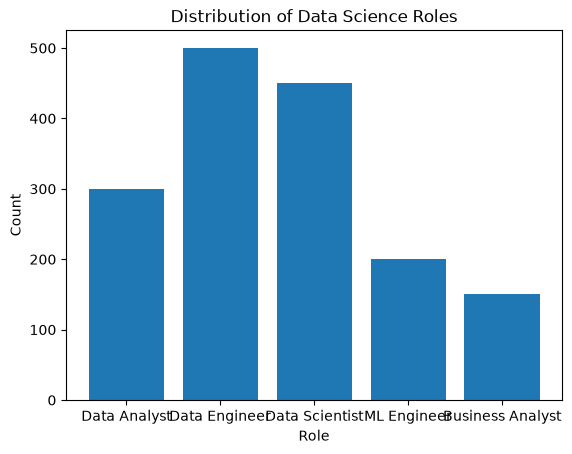

---

## Exp 1c – Structured, unstructured and semi-structured data

**Code** ([exp01c.py](exp01c.py) · [record](docs/exp01c.pdf))

```python
# Exp No: 1.c - Differentiate Structured, Un-structured and Semi-structured data
import pandas as pd

# Structured data example
structured_data = pd.DataFrame({
    'ID': [1, 2, 3],
    'Name': ['Alice', 'Bob', 'Charlie'],
    'Age': [25, 30, 35]
})
print("Structured Data:\n", structured_data)

# Unstructured data example
unstructured_data = "This is an example of unstructured data. It can be a piece of text, an image, or a video file."
print("\nUnstructured Data:\n", unstructured_data)

# Semi-structured data example (JSON)
semi_structured_data = {'ID': 1, 'Name': 'Alice', 'Attributes': {'Height': 165, 'Weight': 68}}
print("\nSemi-structured Data:\n", semi_structured_data)
```

**Output**


---

## Exp 1d – Encrypt and decrypt sensitive data

**Code** ([exp01d.py](exp01d.py) · [record](docs/exp01d.pdf))

```python
# Exp No: 1.d - Encrypt and decrypt given sensitive data
from cryptography.fernet import Fernet

# Generate key and encrypt data
key = Fernet.generate_key()
cipher_suite = Fernet(key)
plain_text = b"Rajalakshmi Engineering College."
cipher_text = cipher_suite.encrypt(plain_text)

# Decrypt data
decrypted_text = cipher_suite.decrypt(cipher_text)
print("Original Data:", plain_text)
print("Encrypted Data:", cipher_text)
print("Decrypted Data:", decrypted_text)
```

**Output**


---

## Exp 3a – Data visualization – line plot

**Code** ([exp03a.py](exp03a.py) · [record](docs/exp03a.pdf))

```python
# Exp No: 3.a - Data visualization using line plot
import matplotlib.pyplot as cricket

Overs = list(range(5, 51, 5))
Indian_Score = [30, 55, 90, 129, 165, 200, 239, 270, 310, 350]
Srilankan_Score = [25, 70, 90, 120, 140, 170, 195, 220, 255, 279]

cricket.plot(Overs, Indian_Score, color="green", label="INDIA")
cricket.plot(Overs, Srilankan_Score, color="red", label="SRILANKA")
cricket.title("INDIA Vs SRILANKA")
cricket.xlabel("Overs")
cricket.ylabel("Score")
cricket.legend(loc="center right")
cricket.show()
```

**Output**


---

## Exp 3b – Data visualization – bar chart

**Code** ([exp03b.py](exp03b.py) · [record](docs/exp03b.pdf))

```python
# Exp No: 3.b - Data visualization using bar chart
import matplotlib.pyplot as hscmark
import numpy as np

Names = ['SHREE', 'DEV', 'KEERTHI', 'PRIYA', 'SHAN', 'KUMARAN']
xaxis = np.arange(len(Names))
Percentage_hsc = [96, 91, 94, 75, 45, 81]
hscmark.bar(Names, Percentage_hsc)
hscmark.xticks(xaxis, Names, rotation=45)
hscmark.xlabel("Names of Pupil")
hscmark.ylabel("Percentage")
hscmark.title("Comparison of HSC Percentage", fontsize=20, color="green")
hscmark.show()
```

**Output**


---

## Exp 3c – Data visualization – pie chart

**Code** ([exp03c.py](exp03c.py) · [record](docs/exp03c.pdf))

```python
# Exp No: 3.c - Data visualization using pie chart
import matplotlib.pyplot as election

# Election data
labels = ['CANDIDATE 1', 'CANDIDATE 2', 'CANDIDATE 3', 'CANDIDATE 4']
Votes = [315, 130, 245, 210]
colors = ['green', 'yellow', 'red', 'orange']
explode = (0.2, 0, 0, 0)

# Plotting the pie chart
election.pie(Votes, labels=labels, colors=colors, explode=explode, autopct='%0.2f%%')
election.title('Election Results')
election.show()
```

**Output**

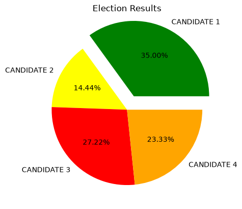

---

## Exp 4 – Word frequency in a body of text (NLTK)

**Code** ([exp04.py](exp04.py) · [record](docs/exp04.pdf))

```python
# Exp No: 4 - Count the frequency of occurrence of a word in a body of text
import ssl
import certifi
import nltk
from nltk.tokenize import word_tokenize
from nltk.corpus import gutenberg

# Use certifi's certificates so nltk.download works on macOS
ssl._create_default_https_context = lambda: ssl.create_default_context(cafile=certifi.where())

# Download the gutenberg corpus if not already installed
nltk.download('gutenberg')
nltk.download('punkt')  # Ensure the punkt tokenizer models are also downloaded
nltk.download('punkt_tab')  # Needed by newer NLTK versions

# Load the text from the gutenberg corpus
sample = gutenberg.raw("austen-emma.txt")

# Tokenize the sample text
token = word_tokenize(sample)

# Create a list of the first 50 tokens
wlist = []
for i in range(50):
    wlist.append(token[i])

# Calculate the frequency of each word in the list
wordfreq = [wlist.count(w) for w in wlist]

# Print the word-frequency pairs
print("Pairs\n" + str(list(zip(wlist, wordfreq))))
```

**Output**

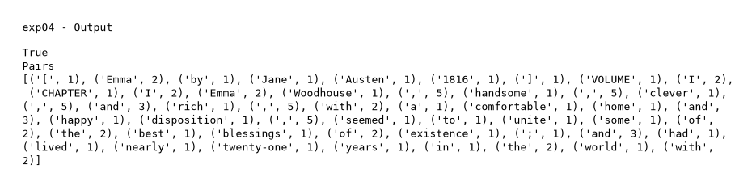

---

## Exp 5 – Data collection and initial exploration (diabetes)

**Code** ([exp05.py](exp05.py) · [record](docs/exp05.pdf))

```python
# Exp No: 5 - Data Collection and Initial Exploration (PIMA Indian Diabetes dataset)
import pandas as pd
import matplotlib.pyplot as plt
import seaborn as sns

# 1. Data Collection - load the dataset
db = pd.read_csv("data/diabetes.csv")

# Display the first few rows
print(db.head())

# 2. Initial Exploration - dataset structure and summary statistics
print(db.info())
print(db.describe())

# Visualize the distribution of each feature
db.hist(bins=50, figsize=(20, 15))
plt.show()

# Pairplot to visualize relationships
sns.pairplot(db)
plt.show()
```

**Output**

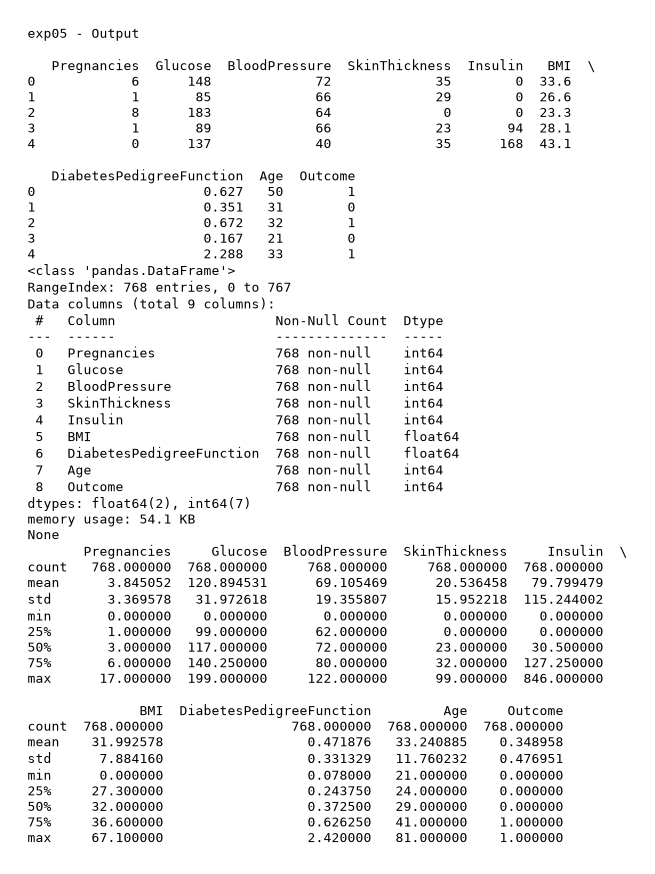

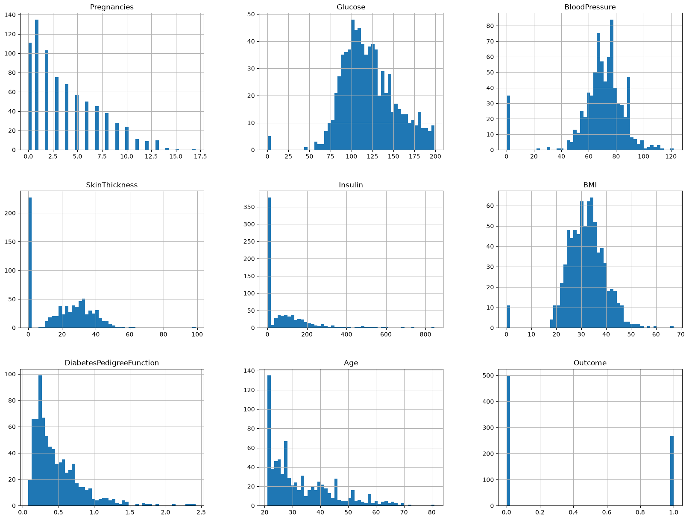

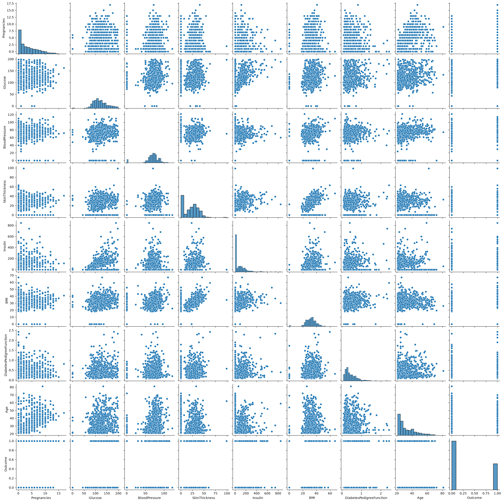

---

## Exp 6 – Time series analysis of website traffic

**Code** ([exp06.py](exp06.py) · [record](docs/exp06.pdf))

```python
# Experiment 6 - Time Series Analysis of Website Traffic
import pandas as pd
import matplotlib.pyplot as plt
from statsmodels.tsa.seasonal import seasonal_decompose

# Load dataset
data = pd.read_csv('data/website_traffic.csv', parse_dates=['Date'], index_col='Date')

# Handle missing values by interpolation
data = data.interpolate()

# Plot the time series data
data[['Page_Views', 'Unique_Visitors']].plot(figsize=(12, 5))
plt.title('Page Views and Unique Visitors')
plt.show()
data['Bounce_Rate'].plot(figsize=(12, 4), color='orange')
plt.title('Bounce Rate')
plt.show()

# Time Series Decomposition
decomposition = seasonal_decompose(data['Page_Views'], model='additive')
decomposition.plot()
plt.show()

# Moving Average
data['Page_Views_MA'] = data['Page_Views'].rolling(window=30).mean()
data[['Page_Views', 'Page_Views_MA']].plot()
plt.title('Page Views with Moving Average')
plt.show()

# Anomaly Detection
data['Page_Views_Z'] = (data['Page_Views'] - data['Page_Views'].mean()) / data['Page_Views'].std()
anomalies = data[data['Page_Views_Z'].abs() > 3]
print("Anomalies detected:\n", anomalies[['Page_Views', 'Page_Views_Z']])
plt.plot(data.index, data['Page_Views'], label='Page Views')
plt.scatter(anomalies.index, anomalies['Page_Views'], color='red', label='Anomalies')
plt.legend()
plt.show()
```

**Output**


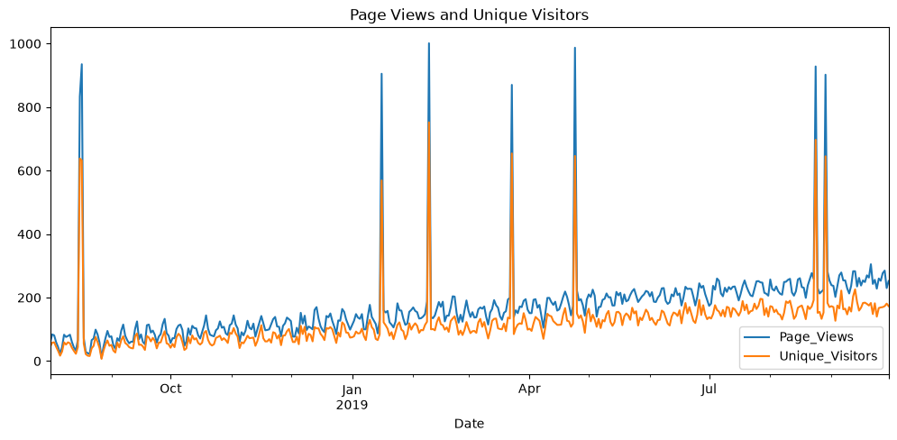


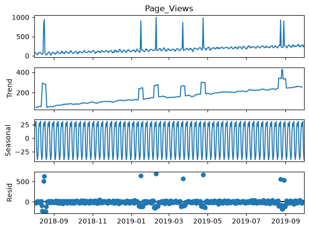


---

## Exp 7 – Random sampling and sampling distribution

**Code** ([exp07.py](exp07.py) · [record](docs/exp07.pdf))

```python
# Experiment 7 - Random Sampling and Sampling Distribution
import numpy as np
import matplotlib.pyplot as plt

# Step 1: Generate a population (e.g., normal distribution)
population_mean = 50
population_std = 10
population_size = 100000
population = np.random.normal(population_mean, population_std, population_size)

# Step 2: Random sampling
sample_sizes = [30, 50, 100]  # different sample sizes to consider
num_samples = 1000  # number of samples for each sample size
sample_means = {}

for size in sample_sizes:
    sample_means[size] = []
    for _ in range(num_samples):
        sample = np.random.choice(population, size=size, replace=False)
        sample_means[size].append(np.mean(sample))

# Step 3: Plotting sampling distributions
plt.figure(figsize=(12, 8))

for i, size in enumerate(sample_sizes):
    plt.subplot(len(sample_sizes), 1, i + 1)
    plt.hist(sample_means[size], bins=30, alpha=0.7, label=f'Sample Size {size}')
    plt.axvline(np.mean(population), color='red', linestyle='dashed', linewidth=1.5, label='Population Mean')
    plt.title(f'Sampling Distribution (Sample Size {size})')
    plt.xlabel('Sample Mean')
    plt.ylabel('Frequency')
    plt.legend()

plt.tight_layout()
plt.show()
```

**Output**


---

## Exp 8 – Z-test

**Code** ([exp08.py](exp08.py) · [record](docs/exp08.pdf))

```python
# Lab Experiment 8 - Conduct Z test for the data given
import numpy as np
import scipy.stats as stats

# Define the sample data (hypothetical weights in grams)
sample_data = np.array([152, 148, 151, 149, 147, 153, 150, 148, 152, 149, 151, 150, 149, 152, 151,
                        148, 150, 152, 149, 150, 148, 153, 151, 150, 149, 152, 148, 151, 150, 153])

# Population mean under the null hypothesis
population_mean = 150

# Calculate sample statistics
sample_mean = np.mean(sample_data)
sample_std = np.std(sample_data, ddof=1)  # Using sample standard deviation

# Number of observations
n = len(sample_data)

# Calculate the Z-statistic
z_statistic = (sample_mean - population_mean) / (sample_std / np.sqrt(n))

# Calculate the p-value
p_value = 2 * (1 - stats.norm.cdf(np.abs(z_statistic)))  # Two-tailed test

# Print results
print(f"Sample Mean: {sample_mean:.2f}")
print(f"Z-Statistic: {z_statistic:.4f}")
print(f"P-Value: {p_value:.4f}")

# Decision based on the significance level
alpha = 0.05
if p_value < alpha:
    print("Reject the null hypothesis: The average weight is significantly different from 150 grams.")
else:
    print("Fail to reject the null hypothesis: There is no significant difference in average weight from 150 grams.")
```

**Output**


---

## Exp 9 – Matplotlib use cases (Iris dataset)

**Code** ([exp09.py](exp09.py) · [record](docs/exp09.pdf))

```python
# Exp No: 9 - Understand Matplotlib library use cases in Data Science through visualization (Iris dataset)
import pandas as pd
import numpy as np
import seaborn as sns
import matplotlib.pyplot as plt

data = pd.read_csv('data/Iris_Dataset.csv')
print(data)

data.info()
print(data.describe())
print(data.value_counts('variety'))

sns.countplot(x='variety', data=data)
plt.show()

dummies = pd.get_dummies(data.variety)
FinalDataset = pd.concat([pd.get_dummies(data.variety), data.iloc[:, [0, 1, 2, 3]]], axis=1)
print(FinalDataset.head())

sns.scatterplot(x='SepalLengthCm', y='SepalWidthCm', hue='variety', data=data)
plt.show()

sns.scatterplot(x='PetalLengthCm', y='PetalWidthCm', hue='variety', data=data)
plt.show()

sns.pairplot(data, hue='variety', height=3)
plt.show()

sns.FacetGrid(data, hue='variety', height=5).map(sns.histplot, 'PetalLengthCm').add_legend()
plt.show()

sns.FacetGrid(data, hue='variety', height=5).map(sns.histplot, 'PetalWidthCm').add_legend()
plt.show()

sns.FacetGrid(data, hue='variety', height=5).map(sns.histplot, 'SepalLengthCm').add_legend()
plt.show()

sns.FacetGrid(data, hue='variety', height=5).map(sns.histplot, 'SepalWidthCm').add_legend()
plt.show()
```

**Output**


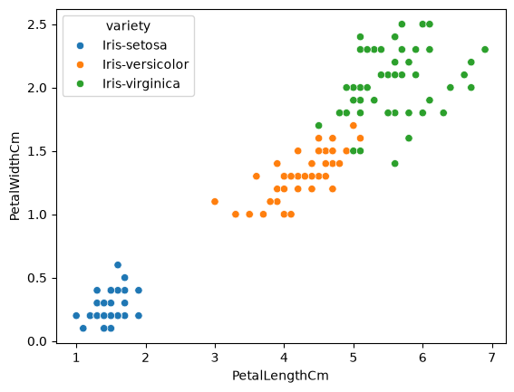


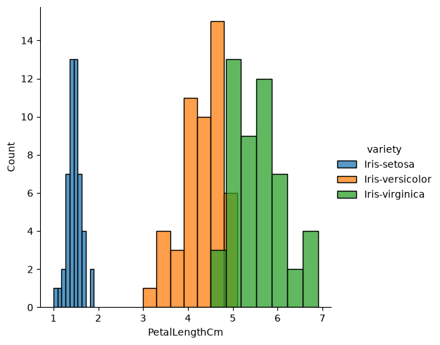


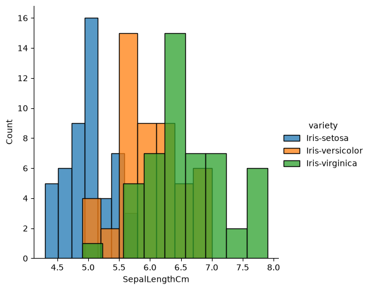


---

## Exp 10 – NumPy array functions

**Code** ([exp10.py](exp10.py) · [record](docs/exp10.pdf))

```python
# Exp No: 10 - Understand array functions in Data Science using NumPy
import numpy as np

array = np.random.randint(1, 100, 9)
print("array:", array)

print("np.sqrt(array):", np.sqrt(array))

print("array.ndim:", array.ndim)

new_array = array.reshape(3, 3)
print("new_array:\n", new_array)

print("new_array.ndim:", new_array.ndim)

print("new_array.ravel():", new_array.ravel())

newm = new_array.reshape(3, 3)
print("newm:\n", newm)

print("newm[2, 1:3]:", newm[2, 1:3])

print("newm[1:2, 1:3]:", newm[1:2, 1:3])

print("new_array[0:3, 0:0]:", new_array[0:3, 0:0])

print("new_array[0:2, 0:1]:\n", new_array[0:2, 0:1])

print("new_array[0:3, 0:1]:\n", new_array[0:3, 0:1])

print("new_array[1:3]:\n", new_array[1:3])
```

**Output**

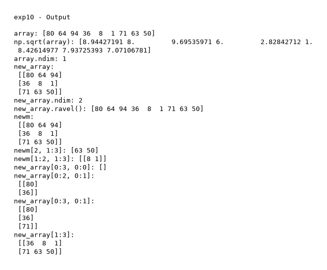

---

## Exp 11 – Pandas DataFrame use cases

**Code** ([exp11.py](exp11.py) · [record](docs/exp11.pdf))

```python
# Exp No: 11 - Understand pandas library use cases in Data Science
import numpy as np
import pandas as pd

list = [[1, 'Smith', 50000], [2, 'Jones', 60000]]

df = pd.DataFrame(list)
print(df)

df.columns = ['Empd', 'Name', 'Salary']
print(df)

df.info()

df = pd.read_csv("data/50_Startups.csv")
df.info()
print(df.head())
print(df.tail())

df = pd.read_csv("data/employee.csv")
print(df.head())
print(df.tail())
df.info()

print(df.salary)
print(type(df.salary))
print("Mean:", df.salary.mean())
print("Median:", df.salary.median())
print("Mode:\n", df.salary.mode())
print("Variance:", df.salary.var())
print("Std:", df.salary.std())

print(df.describe())
print(df.describe(include='all'))

empCol = df.columns
print(empCol)

emparray = df.values
print(emparray)

employee_DF = pd.DataFrame(emparray, columns=empCol)
print(employee_DF)
```

**Output**

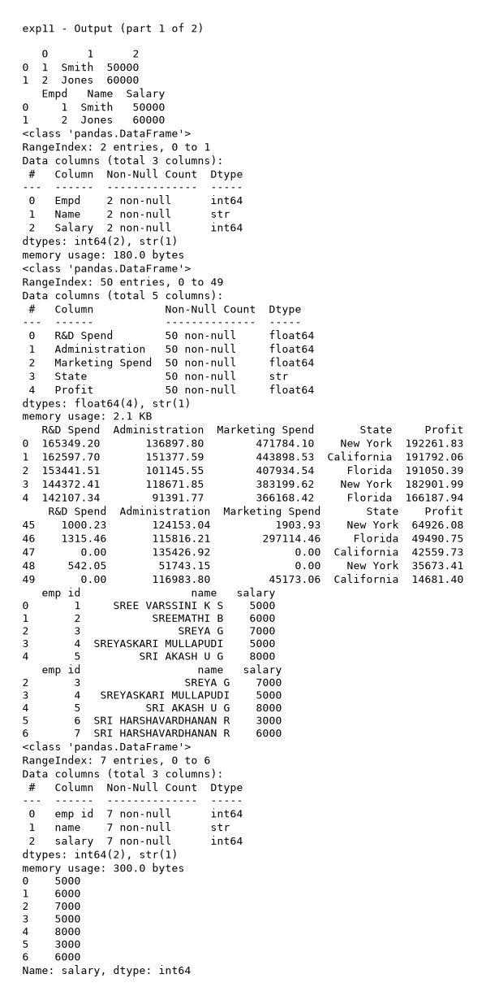

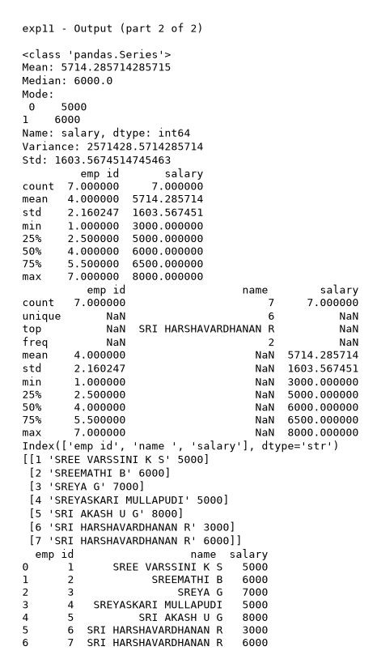

---

## Exp 12 – Outlier detection (IQR)

**Code** ([exp12.py](exp12.py) · [record](docs/exp12.pdf))

```python
# Exp No: 12 - Detect outliers in a given data set
import numpy as np
import seaborn as sns
import matplotlib.pyplot as plt

# sample calculation for low range(lr), upper range(ur), percentile
array = np.random.randint(1, 100, 16)  # randomly generate 16 numbers between 1 to 100
print("array:", array)

print("mean:", array.mean())
print("25th percentile:", np.percentile(array, 25))
print("50th percentile:", np.percentile(array, 50))
print("75th percentile:", np.percentile(array, 75))
print("100th percentile:", np.percentile(array, 100))


# outliers detection
def outDetection(array):
    sorted(array)
    Q1, Q3 = np.percentile(array, [25, 75])
    IQR = Q3 - Q1
    lr = Q1 - (1.5 * IQR)
    ur = Q3 + (1.5 * IQR)
    return lr, ur


lr, ur = outDetection(array)
print("lr, ur:", lr, ur)

sns.displot(array)
plt.show()

sns.histplot(array, kde=True, stat='density')  # replacement for deprecated sns.distplot
plt.show()

new_array = array[(array > lr) & (array < ur)]
print("new_array:", new_array)

sns.displot(new_array)
plt.show()

lr1, ur1 = outDetection(new_array)
print("lr1, ur1:", lr1, ur1)

final_array = new_array[(new_array > lr1) & (new_array < ur1)]
print("final_array:", final_array)

sns.histplot(final_array, kde=True, stat='density')
plt.show()
```

**Output**


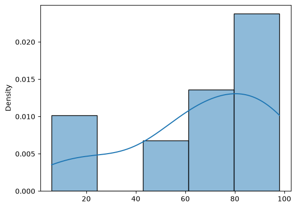

---

## Exp 13 – Handling missing and inappropriate data

**Code** ([exp13.py](exp13.py) · [record](docs/exp13.pdf))

```python
# Exp No: 13 - Handle missing values and inappropriate data in a given data set
import numpy as np
import pandas as pd

# Upload Hotel.csv and convert it into dataFrame
df = pd.read_csv("data/Hotel_Dataset.csv")
print(df)

# From the dataframe identify the duplicate row (i.e row 9)
print(df.duplicated())

df.info()

# The drop_duplicates() method removes duplicate rows
df.drop_duplicates(inplace=True)
print(df)

print("len(df):", len(df))

# Reset the index
index = np.array(list(range(0, len(df))))
df.set_index(index, inplace=True)
print(index)
print(df)

# Drop the duplicate column
df.drop(['Age_Group.1'], axis=1, inplace=True)
print(df)

# Replace inappropriate (negative / out of range) values with NaN
df = df.astype({'CustomerID': float, 'Rating(1-5)': float, 'Bill': float,
                'NoOfPax': float, 'EstimatedSalary': float})
df.loc[df.CustomerID < 0, 'CustomerID'] = np.nan
df.loc[(df['Rating(1-5)'] < 1) | (df['Rating(1-5)'] > 5), 'Rating(1-5)'] = np.nan
df.loc[df.Bill < 0, 'Bill'] = np.nan
df.loc[df.EstimatedSalary < 0, 'EstimatedSalary'] = np.nan
print(df)

df.loc[(df['NoOfPax'] < 1) | (df['NoOfPax'] > 20), 'NoOfPax'] = np.nan
print(df)

print(df.Age_Group.unique())
print(df.Hotel.unique())

df['Hotel'] = df['Hotel'].replace(['Ibys'], 'Ibis')
print(df.FoodPreference.unique())
df['FoodPreference'] = df['FoodPreference'].replace(['Vegetarian', 'veg'], 'Veg')
df['FoodPreference'] = df['FoodPreference'].replace(['non-Veg'], 'Non-Veg')

# Numerical continuous -> mean, numerical discrete -> median, categorical -> mode
df['EstimatedSalary'] = df['EstimatedSalary'].fillna(round(df.EstimatedSalary.mean()))
df['NoOfPax'] = df['NoOfPax'].fillna(round(df.NoOfPax.median()))
df['Rating(1-5)'] = df['Rating(1-5)'].fillna(round(df['Rating(1-5)'].median()))
df['Bill'] = df['Bill'].fillna(round(df.Bill.mean()))
print(df)
```

**Output**

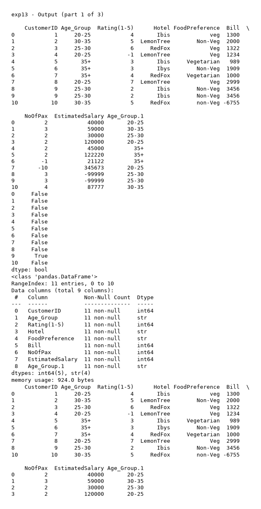

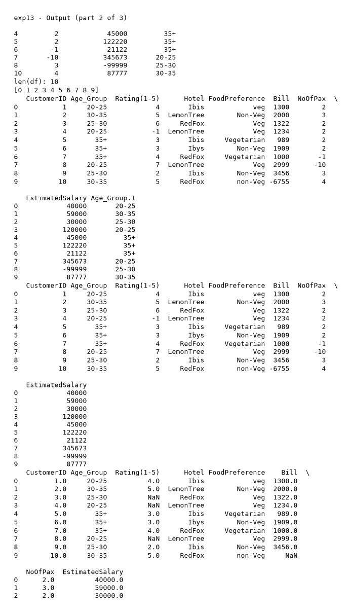

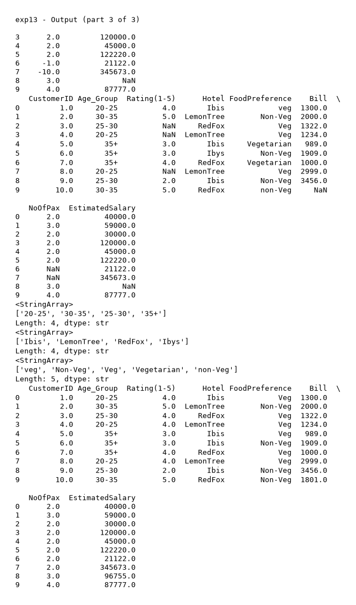

---

## Exp 14 – Feature scaling

**Code** ([exp14.py](exp14.py) · [record](docs/exp14.pdf))

```python
# Exp No: 14 - Understand feature scaling
import numpy as np
import pandas as pd
from sklearn.impute import SimpleImputer
from sklearn.preprocessing import OneHotEncoder, StandardScaler, MinMaxScaler

df = pd.read_csv('data/pre-process_datasample.csv')
print(df)
print(df.head())

df['Country'] = df['Country'].fillna(df.Country.mode()[0])
features = df.iloc[:, :-1].values
label = df.iloc[:, -1].values

age = SimpleImputer(strategy="mean", missing_values=np.nan)
Salary = SimpleImputer(strategy="mean", missing_values=np.nan)
age.fit(features[:, [1]])
Salary.fit(features[:, [2]])

features[:, [1]] = age.transform(features[:, [1]])
features[:, [2]] = Salary.transform(features[:, [2]])
print(features)

oh = OneHotEncoder(sparse_output=False)
Country = oh.fit_transform(features[:, [0]])
print(Country)

final_set = np.concatenate((Country, features[:, [1, 2]]), axis=1)
print(final_set)

sc = StandardScaler()
sc.fit(final_set)
feat_standard_scaler = sc.transform(final_set)
print("Standard Scaler:\n", feat_standard_scaler)

mms = MinMaxScaler(feature_range=(0, 1))
mms.fit(final_set)
feat_minmax_scaler = mms.transform(final_set)
print("MinMax Scaler:\n", feat_minmax_scaler)
```

**Output**


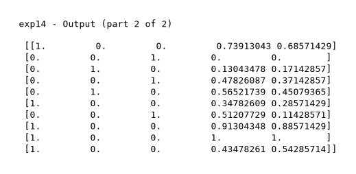

---

## Exp 15 – Data preprocessing

**Code** ([exp15.py](exp15.py) · [record](docs/exp15.pdf))

```python
# Exp No: 15 - Understand data preprocessing in Data Science
import numpy as np
import pandas as pd

df = pd.read_csv("data/pre-process_datasample.csv")
print(df)

df.info()

print(df.Country.mode())
print(df.Country.mode()[0])
print(type(df.Country.mode()))

df['Country'] = df['Country'].fillna(df.Country.mode()[0])
df['Age'] = df['Age'].fillna(df.Age.median())
df['Salary'] = df['Salary'].fillna(round(df.Salary.mean()))
print(df)

print(pd.get_dummies(df.Country))

updated_dataset = pd.concat([pd.get_dummies(df.Country), df.iloc[:, [1, 2, 3]]], axis=1)
print(updated_dataset)

df.info()

updated_dataset['Purchased'] = updated_dataset['Purchased'].replace(['No', 'Yes'], [0, 1])
print(updated_dataset)
```

**Output**


---

## Exp 16 – EDA – quantitative and qualitative analysis

**Code** ([exp16.py](exp16.py) · [record](docs/exp16.pdf))

```python
# Exp No: 16 - Understand EDA - Quantitative and Qualitative analysis (tips dataset)
import seaborn as sns
import pandas as pd
import numpy as np
import matplotlib.pyplot as plt

tips = pd.read_csv('data/tips.csv')  # same as sns.load_dataset('tips')
print(tips.head())

sns.displot(tips.total_bill, kde=True)
plt.show()

sns.displot(tips.total_bill, kde=False)
plt.show()

sns.jointplot(x=tips.tip, y=tips.total_bill)
plt.show()

sns.jointplot(x=tips.tip, y=tips.total_bill, kind="reg")
plt.show()

sns.jointplot(x=tips.tip, y=tips.total_bill, kind="hex")
plt.show()

sns.pairplot(tips)
plt.show()

print(tips.time.value_counts())

sns.pairplot(tips, hue='time')
plt.show()

sns.pairplot(tips, hue='day')
plt.show()

sns.heatmap(tips.corr(numeric_only=True), annot=True)
plt.show()

sns.boxplot(tips.total_bill)
plt.show()

sns.boxplot(tips.tip)
plt.show()

sns.countplot(tips.day)
plt.show()

sns.countplot(tips.sex)
plt.show()

tips.sex.value_counts().plot(kind='pie')
plt.show()

tips.sex.value_counts().plot(kind='bar')
plt.show()

sns.countplot(tips[tips.time == 'Dinner']['day'])
plt.show()
```

**Output**


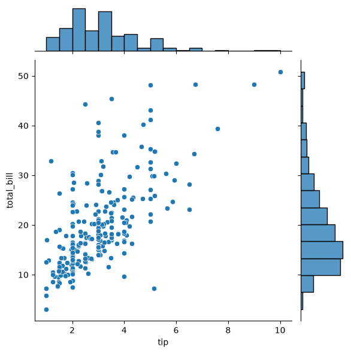

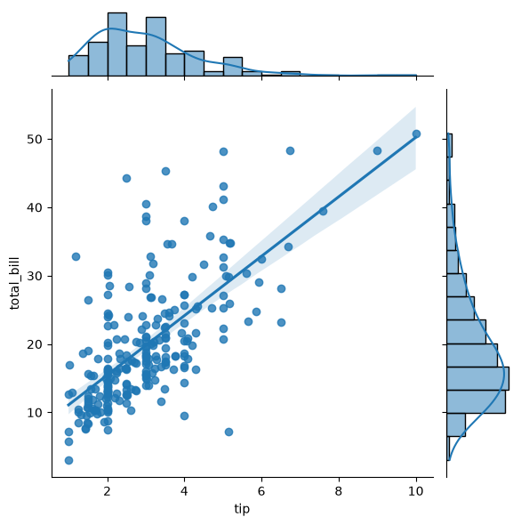


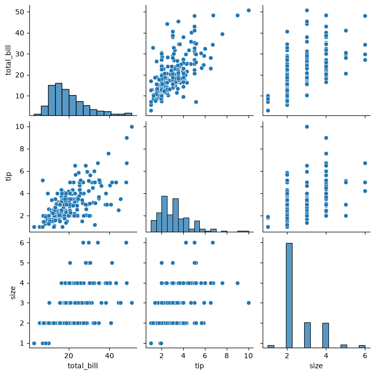

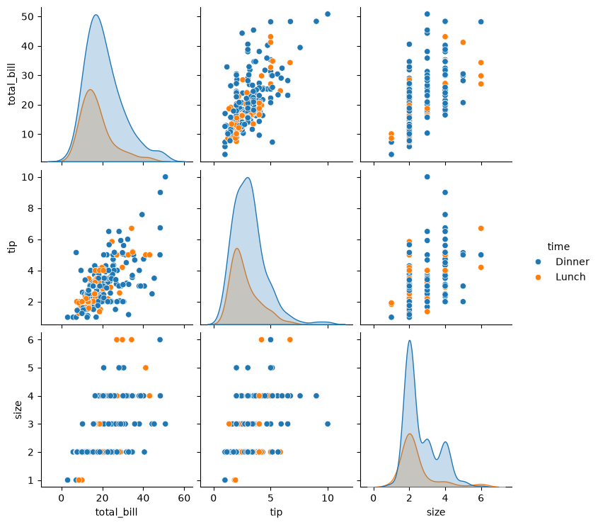


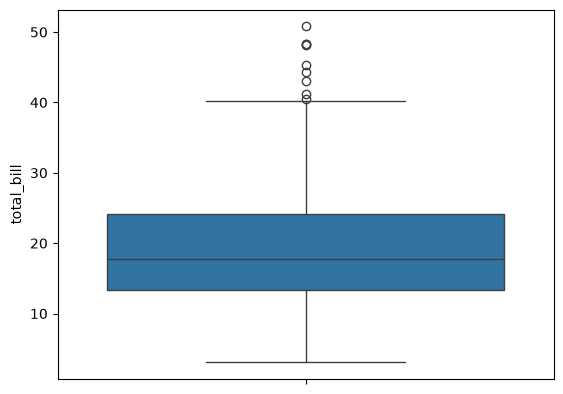


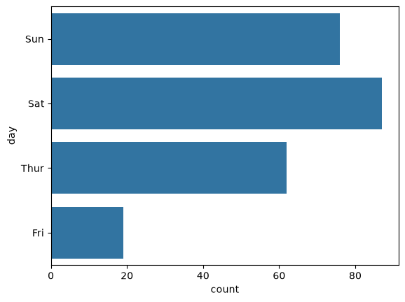


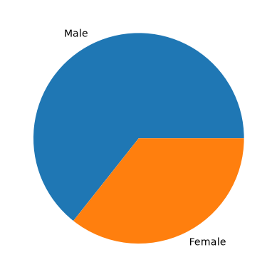


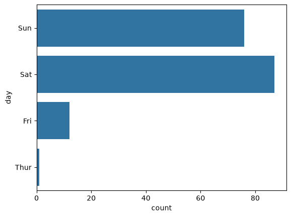

---

## Exp 17 – Linear regression

**Code** ([exp17.py](exp17.py) · [record](docs/exp17.pdf))

```python
# Exp No: 17 - Understand Linear Regression for a given data set
import numpy as np
import pandas as pd
import pickle
from sklearn.model_selection import train_test_split
from sklearn.linear_model import LinearRegression

df = pd.read_csv('data/Salary_data.csv')
print(df)

df.info()
df.dropna(inplace=True)
df.info()
print(df.describe())

features = df.iloc[:, [0]].values
label = df.iloc[:, [1]].values

x_train, x_test, y_train, y_test = train_test_split(features, label, test_size=0.2, random_state=23)

model = LinearRegression()
model.fit(x_train, y_train)

print("Train score:", model.score(x_train, y_train))
print("Test score:", model.score(x_test, y_test))
print("Coefficient:", model.coef_)
print("Intercept:", model.intercept_)

pickle.dump(model, open('SalaryPred.model', 'wb'))
model = pickle.load(open('SalaryPred.model', 'rb'))

yr_of_exp = float(input("Enter Years of Experience: "))
yr_of_exp_NP = np.array([[yr_of_exp]])
Salary = model.predict(yr_of_exp_NP)
print("Estimated Salary for {} years of experience is {}: ".format(yr_of_exp, Salary))
```

**Output**


---

## Exp 18 – KNN algorithm

**Code** ([exp18.py](exp18.py) · [record](docs/exp18.pdf))

```python
# Exp No: 18 - Understand KNN algorithm for a given data set
import numpy as np
import pandas as pd
from sklearn.model_selection import train_test_split
from sklearn.neighbors import KNeighborsClassifier
from sklearn.metrics import confusion_matrix, classification_report

df = pd.read_csv('data/Iris.csv')
df.info()
print(df.variety.value_counts())
print(df.head())

features = df.iloc[:, :-1].values
label = df.iloc[:, 4].values

xtrain, xtest, ytrain, ytest = train_test_split(features, label, test_size=.2, random_state=1)
model_KNN = KNeighborsClassifier(n_neighbors=5)
model_KNN.fit(xtrain, ytrain)

print(model_KNN.score(xtrain, ytrain))
print(model_KNN.score(xtest, ytest))

print(confusion_matrix(label, model_KNN.predict(features)))
print(classification_report(label, model_KNN.predict(features)))
```

**Output**

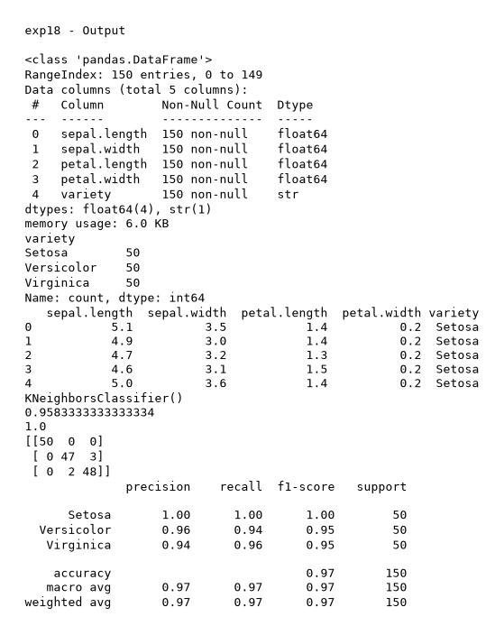

---

## Exp 19 – Logistic regression

**Code** ([exp19.py](exp19.py) · [record](docs/exp19.pdf))

```python
# Exp No: 19 - Understand Logistic Regression for a given data set
import numpy as np
import pandas as pd
from sklearn.model_selection import train_test_split
from sklearn.linear_model import LogisticRegression
from sklearn.metrics import classification_report

df = pd.read_csv('data/Social_Network_Ads.csv')
print(df)
print(df.head())

features = df.iloc[:, [2, 3]].values
label = df.iloc[:, 4].values
print(features)
print(label)

# Find random states where the test score is better than the train score
for i in range(1, 401):
    x_train, x_test, y_train, y_test = train_test_split(features, label, test_size=0.2, random_state=i)
    model = LogisticRegression()
    model.fit(x_train, y_train)
    train_score = model.score(x_train, y_train)
    test_score = model.score(x_test, y_test)
    if test_score > train_score:
        print("Test {} Train{} Random State {}".format(test_score, train_score, i))

x_train, x_test, y_train, y_test = train_test_split(features, label, test_size=0.2, random_state=314)
finalModel = LogisticRegression()
finalModel.fit(x_train, y_train)

print(finalModel.score(x_train, y_train))
print(finalModel.score(x_test, y_test))

print(classification_report(label, finalModel.predict(features)))
```

**Output**


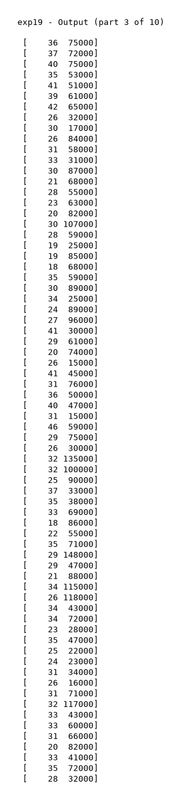

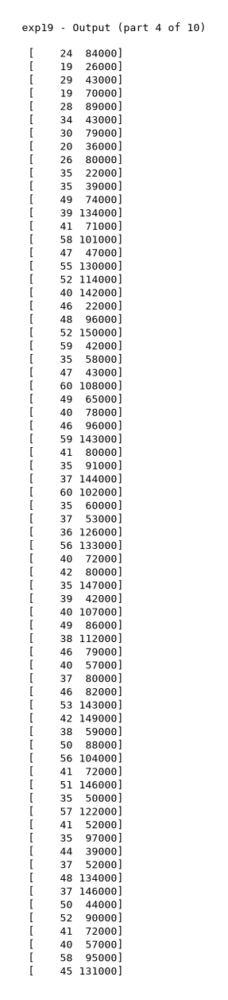


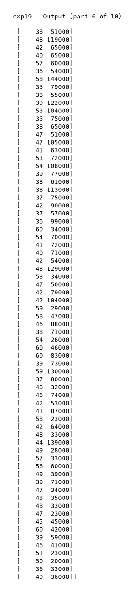

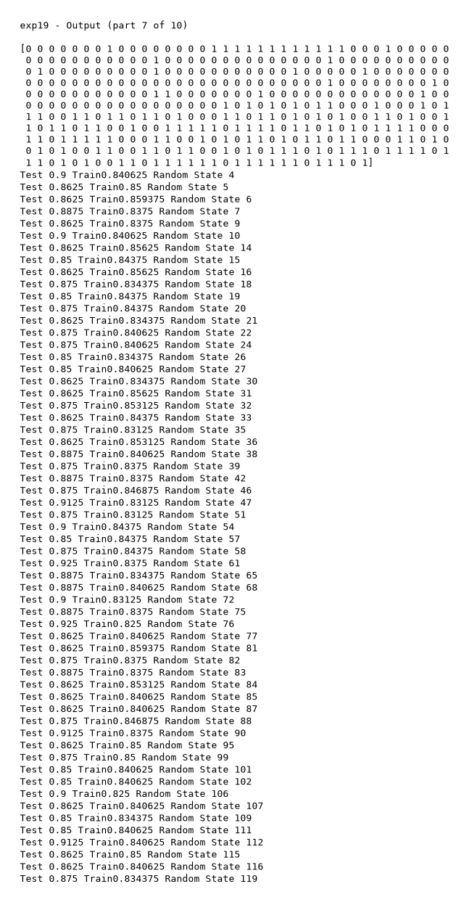

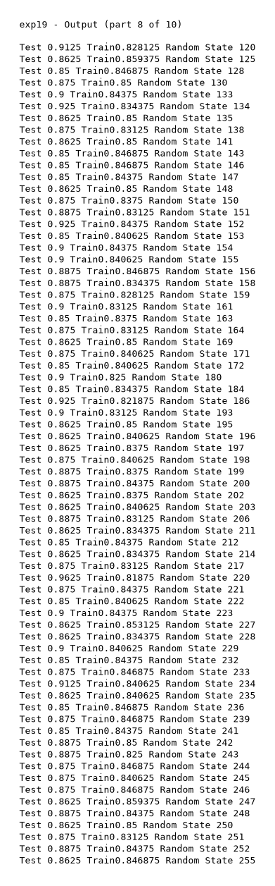

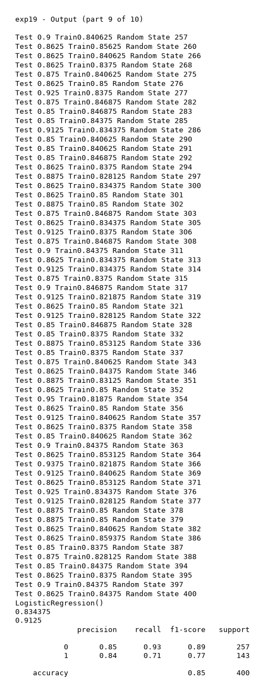


---

## Exp 20 – K-means clustering

**Code** ([exp20.py](exp20.py) · [record](docs/exp20.pdf))

```python
# Exp No: 20 - Understand K-means clustering algorithm for a given data set
import numpy as np
import pandas as pd
import matplotlib.pyplot as plt
import seaborn as sns
from sklearn.cluster import KMeans

df = pd.read_csv('data/Mall_Customers.csv')
df.info()
print(df.head())

sns.pairplot(df)
plt.show()

features = df.iloc[:, [3, 4]].values

model = KMeans(n_clusters=5, n_init=10)
model.fit(features)

Final = df.iloc[:, [3, 4]].copy()
Final['label'] = model.predict(features)
print(Final.head())

sns.set_style("whitegrid")
sns.FacetGrid(Final, hue="label", height=8) \
    .map(plt.scatter, "Annual Income (k$)", "Spending Score (1-100)") \
    .add_legend()
plt.show()

# Elbow method
features_el = df.iloc[:, [2, 3, 4]].values
wcss = []
for i in range(1, 10):
    model = KMeans(n_clusters=i, n_init=10)
    model.fit(features_el)
    wcss.append(model.inertia_)
plt.plot(range(1, 10), wcss)
plt.title('Elbow Method')
plt.xlabel('Number of clusters')
plt.ylabel('WCSS')
plt.show()
```

**Output**

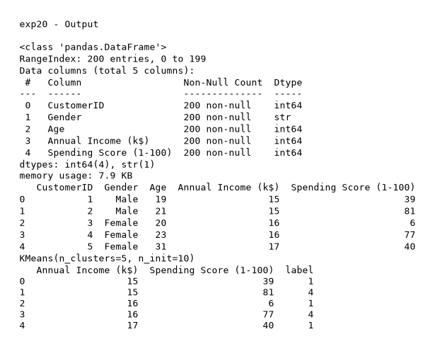


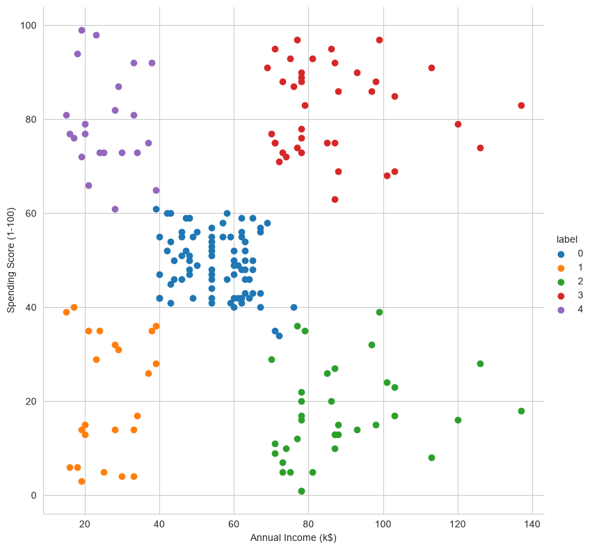

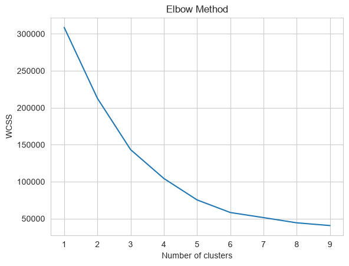

---
